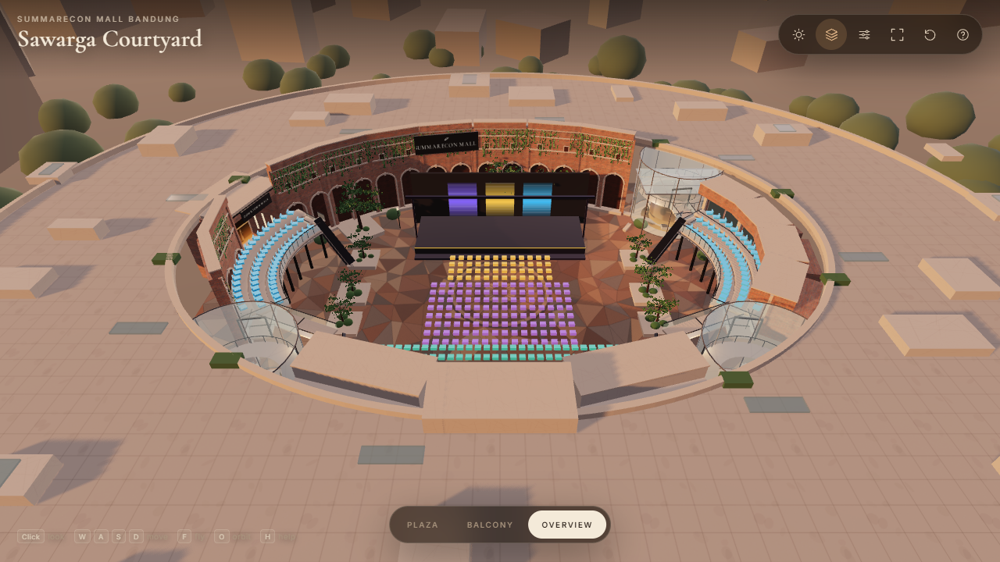

# Sawarga Courtyard — Summarecon Mall Bandung

A real-time, stylized-realistic reconstruction of the open-air **Sawarga Courtyard** at Summarecon Mall Bandung, built with Three.js, Vite, and TypeScript.

It now includes a **ticketing venue layer** prepared for the Pataka ticketing system: a 44 × 41 m event floor inside the larger Sawarga shell, 446 seat proxies, a stage, an announcement board, a ticket booth, and curved shell-attached TRIB balconies. The original ticketing project is **not modified** — the migration checklist is in [`artifacts/ticketing-migration.md`](artifacts/ticketing-migration.md).



## Run

```bash
npm install
npm run dev        # http://127.0.0.1:5188
npm run build      # typecheck + production build
npm run preview    # production preview on 5188
npm run verify:venue
```

## Controls

| Action | Desktop | Mobile |
| --- | --- | --- |
| Move | `W` `A` `S` `D` | Left-side floating joystick |
| Look | Click canvas, then mouse | Right-side drag |
| Sprint | `Shift` | Full joystick tilt |
| Fly | `F` | `Fly` button |
| Vertical (fly) | `Space` / `Ctrl` | `↑` / `↓` |
| Orbit mode | `O` | Overview preset |
| Camera presets | `1` `2` `3` | Preset pills |
| Event layout on/off | Layers icon | Layers icon |
| Layout overlay | `L` | `?layout=1` or `?debug=1` |
| Reset | `R` | Reset icon |
| Help | `H` | Help icon |

Quality presets are available from the sliders icon: **Auto / Low / Medium / High**. Auto starts at medium on desktop and low on mobile, then steps down once if frame time stays above ~24 ms.

## Two modes

- **Event layout** (default) — the ticketing venue proxies, curved TRIB balconies, stage, board, booth, and seat grid are visible. The curved balconies and access are permanent architecture.
- **Clean courtyard** — use the layers icon to hide the event proxies. The Sawarga architecture, curved balconies, atria, paving, and landscape remain.

The venue proxies are intentionally lightweight stand-ins, not the final ticketing UI models.

## Ticketing venue fit

- Original ticketing event floor: **44 × 41 m** (`x −22…22`, `z −18…23`).
- Sawarga shell: **70 × 50 m** ellipse (`radiusX 35`, `radiusZ 25`).
- Stage: 26 × 9 platform at `(0, −13)`; 28 × 9.2 backdrop at `z −17.8`.
- Seats: **446** — VIP 48, CAT 1 128, TRIB 120, REG 150.
- TRIB: 3 rows × 20 × 2 sides, re-laid on **curved, shell-attached 6 m balconies** between the atria. Same IDs and 120 count; positions/rotations are new.
- Board and booth: exact original positions at `z 22`, rotations `2.72` / `−2.72`.
- Access: atria portals/bridges, the original `x ±18…21, z 14…20` stairs retained as the secondary route, plus new NE/NW access towers.
- Fit checks: board/booth clear the rear floor seats by **2.26 m / 2.12 m**; nearest seat spacing **0.828 m**.

Seat-map preview: [`artifacts/venue-seat-map.svg`](artifacts/venue-seat-map.svg).

## What is in the scene

- **Oval courtyard** from the mall floor plan, with the curved retail band, three atria (Ciunik, Cibadak, Cileutik), and the south entrance.
- **Hero brick wall** with blind arches, stone archivolts, framed vents, string courses, parapet, and hanging vines.
- **Two-level arcade and storefronts** with recessed glass, warm interiors, balcony slabs, glass railings, fascia signs, and shopfront glazing.
- **South portal** with a glass curtain wall, warm lobby, canopy with recessed downlights, and “Sawarga Courtyard” signage.
- **Downtown Walk passage** with a lit interior and directional sign.
- **Glass atria** with a warm interior core, mezzanine ring, slim steel frames, and a glass canopy at Cileutik.
- **Curved ticketing balconies**: stepped decks, glass railings, support columns, atria bridges/portals, retained original stairs, and new access towers.
- **Procedural paving** with a large-format triangulated stone pattern, grout, subtle color variation, and a circular medallion.
- **Landscape**: instanced trees with alpha-card canopies, planter shrubs, hedges, stone benches, light poles, and vines. Venue-side trees are kept low so the balconies retain a clear stage sightline.
- **Mall roof** with panel seams, skylights, planters, and rooftop equipment; distant city and treeline silhouettes for the overview.
- **Lighting**: hand-painted sunset/day sky, HDRI environment lighting, warm key + fill, soft shadows, ACES tone mapping, fog, and quality-scaled render settings.
- **Layout overlay** (`L`): original 96 × 80 world, 44 × 41 event floor, stage, seat field, board/booth, curved balconies, and atria access.

## Project structure

```
src/
  app/App.ts              renderer, asset loading, scene assembly, loop, quality/time state
  controls/
    CameraRig.ts          walk/fly/orbit, pointer lock, touch, presets, transitions
    CollisionWorld.ts     ellipse boundary + circle/box obstacle resolution
  scene/
    config.ts             dimensions, palette, quality tiers, asset paths
    materials.ts          PBR material library and sign/interior textures
    batch.ts              static geometry merging
    paving.ts             procedural courtyard floor and curb
    facades.ts            brick wall, arcade, storefronts, portal, atria
    landscape.ts          trees, planters, vines, benches, lights
    context.ts            mall roof, distant city, ground
    lighting.ts           sky, sun, fill, fog, time-of-day, quality
    branding.ts           Summarecon / Sawarga / Downtown Walk signs
    venue/
      layout.ts           pure ticketing world/seat data + curved TRIB math
      balconies.ts        curved decks, railings, access, stairs, bridges
      eventProxies.ts     stage/seats/board/booth layout proxies
      overlay.ts          dimension/layout overlay
  ui/UI.ts                loading, toolbar, presets, help, quality, touch controls
  utils/                  seeded RNG, geometry helpers, canvas textures
public/assets/            HDRIs, brick PBR maps, favicon
artifacts/                evidence, seat map, migration checklist, progress notes
```

## Verification

```bash
npm run verify:venue     # 446-seat, clearance, spacing, curved-TRIB checks + SVG
npm run build
npm run smoke            # headed browser, desktop + mobile controls
npm run performance -- --headed
node scripts/inspect-threejs-canvas.mjs \
  --manifest artifacts/evidence.json --url http://127.0.0.1:5188 --seed 42
python "C:\Users\Asus\.agents\skills\threejs-game-director\scripts\check_evidence.py" \
  . --manifest artifacts/evidence.json
```

Current evidence pass: **`artifacts/courtyard-pass-9/`** — 8 declared captures, all PASS, checker passed. Renderer diagnostics at 1280×720 and 390×844:

| Capture | Entropy | Edge density | Contrast | Dominant |
| --- | --- | --- | --- | --- |
| Desktop plaza | 6.46 | 0.378 | 176.3 | 0.096 |
| Desktop balcony | 7.41 | 0.484 | 179.9 | 0.035 |
| Desktop overview | 5.22 | 0.328 | 117.0 | 0.272 |
| Desktop layout | 5.32 | 0.344 | 117.6 | 0.268 |
| Desktop day plaza | 6.70 | 0.377 | 203.9 | 0.088 |
| Mobile plaza | 5.86 | 0.314 | 168.0 | 0.100 |
| Mobile overview | 5.85 | 0.375 | 116.8 | 0.156 |
| Mobile layout | 5.97 | 0.395 | 117.5 | 0.153 |

Performance was measured in a **headed** browser on the available AMD Radeon Vega 8 (headless Chromium uses SwiftShader and is not representative):

| Mode | Quality | Avg frame | FPS (uncapped) | Draw calls | Triangles | Textures |
| --- | --- | --- | --- | --- | --- | --- |
| Desktop 1440×900 | auto / medium | 9.15 ms | 109 | 61 | 57,328 | 24 |
| Desktop 1440×900 | high | 12.69 ms | 79 | 61 | 57,328 | 24 |
| Mobile 390×844 | auto / low | 6.62 ms | 151 | 59 | 57,272 | 24 |

A normal display caps to 60 fps; the frame budget is comfortably met. The scene is static, so shadow maps are frozen after the first three frames and refreshed on time/quality changes. Static architecture is merged by material; trees/vines/shrubs/seat proxies are instanced.

## Moving this into the ticketing project

See [`artifacts/ticketing-migration.md`](artifacts/ticketing-migration.md). Short version:

- Copy the pure `src/scene/venue/layout.ts` seat/curve data into the ticketing project.
- Update the original `seatLayout.ts` TRIB positions/rotation, `layout.ts` balcony walkability/routes, `SeatMap2D` scaling, and the `Seats` proxy rotations.
- Render the curved balcony/access group via `<primitive>` or GLB.
- Keep the original night lighting, controls, collision, and booking UI.
- Do **not** import this project’s sky/HDRI/controls/camera into the ticketing app.
- The original project is untouched until that separate integration pass.

## Assets and licensing

- **Poly Haven** (CC0): sunset/day HDRIs, red brick PBR maps.
- **Three.js** (MIT), **Vite**, **Delaunator** (ISC), **Cormorant Garamond** / **Inter** (OFL).
- Procedural canvas textures, paving, sky, interiors, signs, foliage, and geometry are generated here.

The Summarecon name and marks belong to their respective owners. The sign is included at the project owner’s request; obtain permission before commercial publication. The courtyard is an interpretive reconstruction from three reference photos and the published floor plan — not a survey or photogrammetric capture.

## Known limits / next passes

- The ticketing seats, stage, board, and booth are **layout proxies**; the final ticketing components will replace them.
- The original ticketing project has **not** been modified. Its TRIB seats/2D map/collision/tests still need the migration pass.
- The venue currently keeps the existing Sawarga atria names/positions (Ciunik SW, Cibadak SE, Cileutik NE); reconcile with the ticketing design copy when merging.
- TRIB remains 120 seats. If the count changes later, update quotas/seed/2D map/count tests together.
- Walking remains plaza/ground-level; curved balconies are explored in fly/orbit. The ticketing project’s character will use its own collision.
- No event crowd, temporary tents, or audio yet.
