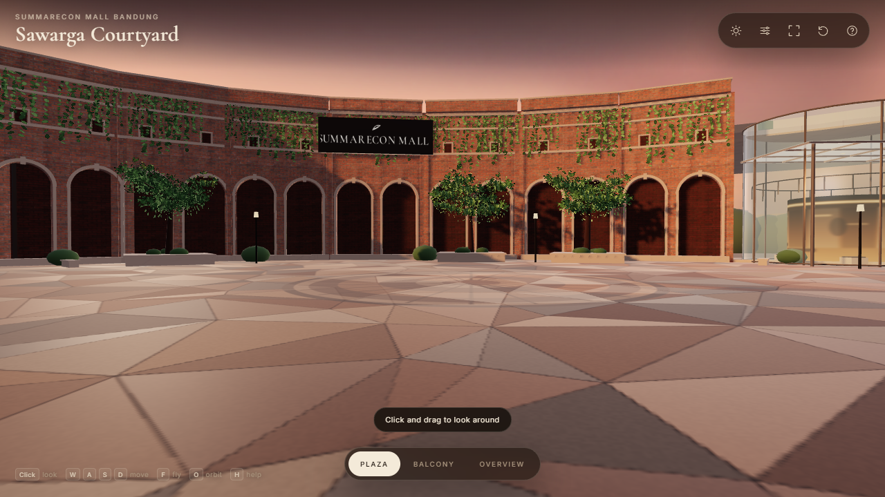

# Sawarga Courtyard — Summarecon Mall Bandung

A real-time, stylized-realistic reconstruction of the open-air **Sawarga Courtyard** at Summarecon Mall Bandung, built with Three.js, Vite, and TypeScript.

The plaza is intentionally **clean**: no event stage, tents, basketball court, or crowd. The architecture, landscape, and lighting are authored so the environment can be reused or dressed for another purpose.



## Run

```bash
npm install
npm run dev        # http://127.0.0.1:5188
npm run build      # typecheck + production build
npm run preview    # production preview on 5188
```

## Controls

| Action | Desktop | Mobile |
| --- | --- | --- |
| Move | `W` `A` `S` `D` | Left-side floating joystick |
| Look | Click canvas, then mouse | Right-side drag |
| Sprint | `Shift` | Full joystick tilt |
| Fly | `F` | `Fly` button |
| Vertical (fly) | `Space` / `Ctrl` | `↑` / `↓` |
| Orbit mode | `O` | Overview preset |
| Camera presets | `1` `2` `3` | Preset pills |
| Reset | `R` | Reset icon |
| Help | `H` | Help icon |

Quality presets are available from the sliders icon: **Auto / Low / Medium / High**. Auto starts at medium on desktop and low on mobile, then steps down once if frame time stays above ~24 ms.

## What is in the scene

- **Oval courtyard** derived from the mall floor plan, with the curved retail band, three atria (Ciunik, Cibadak, Cileutik), and the south entrance.
- **Hero brick wall** with blind arches, stone archivolts, framed vents, string courses, parapet, and hanging vines.
- **Two-level arcade and storefronts** with recessed glass, warm interiors, balcony slabs, glass railings, fascia signs, and shopfront glazing.
- **South portal** with a glass curtain wall, warm lobby, canopy with recessed downlights, and “Sawarga Courtyard” signage.
- **Downtown Walk passage** with a lit interior and directional sign.
- **Glass atria** with a warm interior core, mezzanine ring, slim steel frames, and a glass canopy at Cileutik.
- **Procedural paving** generated with Delaunator: a large-format triangulated stone pattern, grout, subtle color variation, and a circular medallion.
- **Landscape**: instanced trees with alpha-card canopies, planter shrubs, hedges, stone benches, light poles, and vines.
- **Mall roof** with panel seams, skylights, planters, and rooftop equipment; distant city and treeline silhouettes for the overview.
- **Lighting**: hand-painted sunset/day sky, HDRI environment lighting, warm key + fill, soft shadows, ACES tone mapping, fog, and quality-scaled render settings.

## Project structure

```
src/
  app/App.ts              renderer, asset loading, scene assembly, loop, quality/time state
  controls/
    CameraRig.ts          walk/fly/orbit, pointer lock, touch, presets, transitions
    CollisionWorld.ts     ellipse boundary + circle/box obstacle resolution
  scene/
    config.ts             dimensions, palette, quality tiers, asset paths
    materials.ts          PBR material library and sign/interior textures
    batch.ts              static geometry merging
    paving.ts             procedural courtyard floor and curb
    facades.ts            brick wall, arcade, storefronts, portal, atria
    landscape.ts          trees, planters, vines, benches, lights
    context.ts            mall roof, distant city, ground
    lighting.ts           sky, sun, fill, fog, time-of-day, quality
    branding.ts           Summarecon / Sawarga / Downtown Walk signs
  ui/UI.ts                loading, toolbar, presets, help, quality, touch controls
  utils/                  seeded RNG, geometry helpers, canvas textures
public/assets/            HDRIs, brick PBR maps, favicon
artifacts/                evidence manifest, captures, progress notes
```

## Assets and licensing

All runtime assets are free for use:

- **Poly Haven** (CC0): `belfast_sunset_puresky_2k.hdr`, `kloppenheim_06_puresky_2k.hdr`, red brick diffuse/normal/roughness/AO maps.
- **Three.js** (MIT), **Vite**, **Delaunator** (ISC), **Cormorant Garamond** and **Inter** (SIL Open Font License).
- Procedural canvas textures, paving, sky, interiors, signs, trees, and geometry are generated in this project.

The Summarecon name and marks belong to their respective owners. The sign is included at the project owner’s request; obtain permission before commercial publication. The courtyard is an interpretive reconstruction from three reference photos and the published floor plan — not a survey or photogrammetric capture.

## Verification

The capture manifest is `artifacts/evidence.json`. With the dev server running:

```bash
node scripts/inspect-threejs-canvas.mjs \
  --manifest artifacts/evidence.json \
  --url http://127.0.0.1:5188 \
  --seed 42

python "C:\Users\Asus\.agents\skills\threejs-game-director\scripts\check_evidence.py" \
  . --manifest artifacts/evidence.json
```

Current evidence pass: `artifacts/courtyard-pass-6/` (desktop plaza/balcony/overview/day, mobile plaza/overview). Renderer diagnostics at 1280×720 and 390×844:

| Capture | Entropy | Edge density | Contrast | Dominant |
| --- | --- | --- | --- | --- |
| Desktop plaza | 6.12 | 0.410 | 158.1 | 0.068 |
| Desktop balcony | 6.57 | 0.441 | 182.5 | 0.072 |
| Desktop overview | 5.09 | 0.316 | 113.0 | 0.270 |
| Desktop day plaza | 6.56 | 0.395 | 201.9 | 0.054 |
| Mobile plaza | 5.93 | 0.317 | 146.3 | 0.074 |
| Mobile overview | 5.58 | 0.338 | 112.9 | 0.153 |

Performance was measured in a **headed** browser on the available AMD Radeon Vega 8 (headless Chromium uses SwiftShader and is not representative):

| Mode | Quality | Avg frame | FPS (uncapped) | Draw calls | Triangles | Textures |
| --- | --- | --- | --- | --- | --- | --- |
| Desktop 1440×900 | auto / medium | 5.32 ms | 188 | 44 | 39,570 | 21 |
| Desktop 1440×900 | high | 5.83 ms | 171 | 44 | 39,570 | 21 |
| Mobile 390×844 | auto / low | 5.27 ms | 190 | 44 | 39,570 | 21 |

A normal display caps to 60 fps; the frame budget is comfortably met. The scene is static, so shadow maps are frozen after the first three frames and refreshed when the time of day or quality changes. Static architecture is merged by material, trees/vines/shrubs are instanced, and alpha-tested foliage casts shadows through a custom depth material.

## Known limits / next passes

- The courtyard is an **interpretive** reconstruction. The reference photos do not cover the occluded sides of every volume; those areas are plausible inventions.
- The plaza is deliberately clean. An optional event kit (stage, tents, court, crowd), audio, and a GLB export can be added later.
- Walking is limited to the plaza and ground-level arcade; upper levels are explored in fly/orbit mode.
- The reference’s dense event crowd and temporary stalls are intentionally omitted.
- Branding can be hidden or replaced in `src/scene/branding.ts` and `src/scene/materials.ts` when reusing the environment elsewhere.


